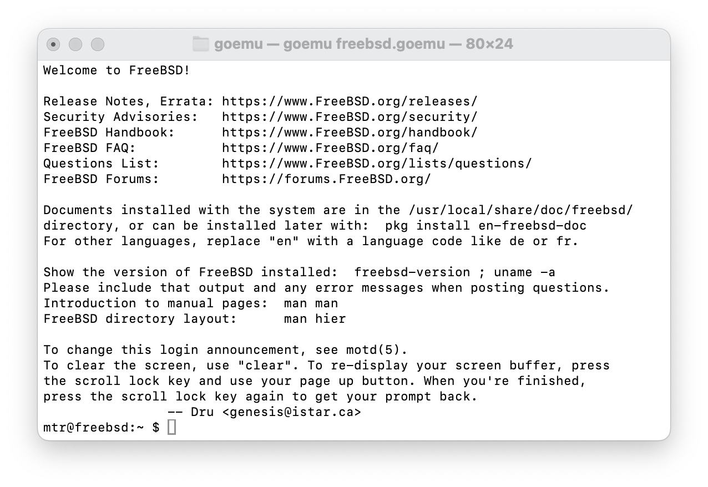
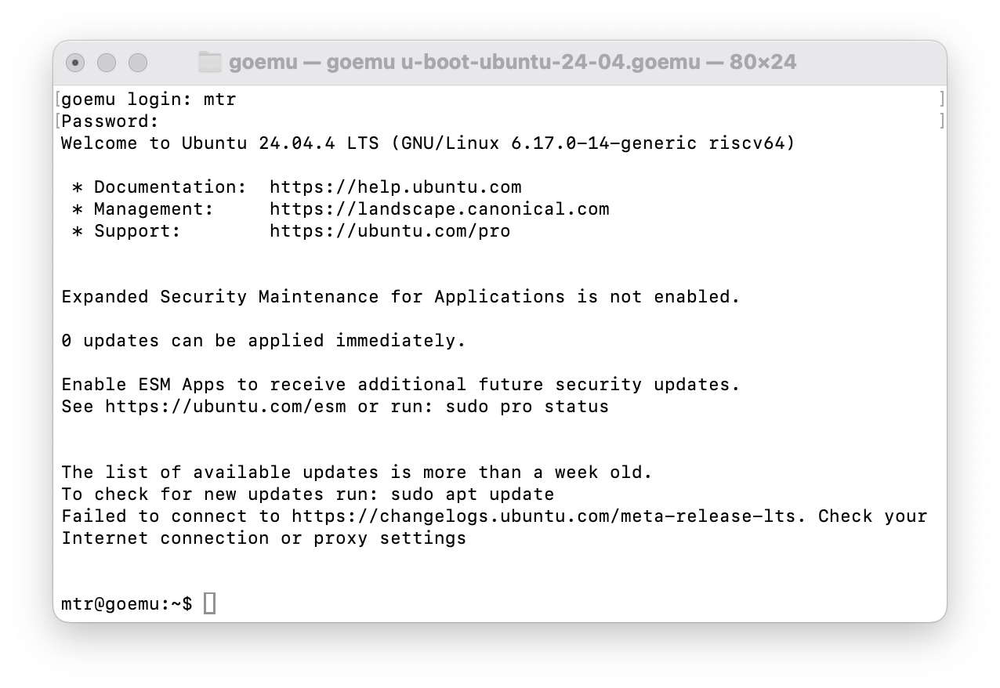
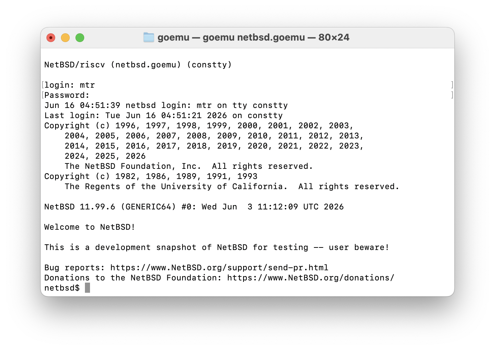
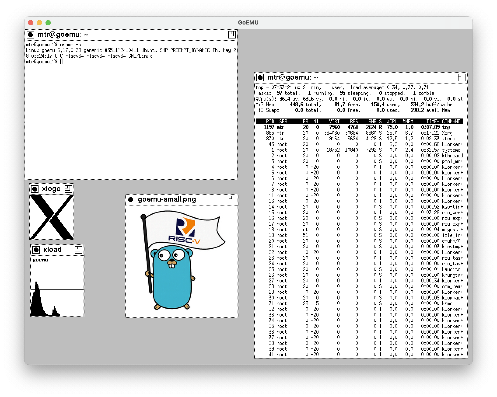

# RISC-V in Go

<p align="center">
  
</p>

**goemu** is a readable, pure-Go implementation of a RISC-V computer
system. It combines a RISC-V CPU emulator, privileged architecture,
virtual memory, interrupt controllers, firmware, and virtual devices
into a complete platform capable of running modern operating systems.

The project implements RV64GC and RVA23U64 functionality, including
the RISC-V Vector Extension (RVV 1.0), and supports OpenSBI, U-Boot,
EFI, GRUB, and VirtIO devices.

The primary goal is correctness, readability, and maintainability. The
CPU implementation serves as an architectural reference and as a
foundation for experimenting with secure computation and a virtual MPC
RISC-V processor.

## Operating systems

goemu has successfully booted and executed:

| Operating system | Status                                  |
| ---              | ---                                     |
| Buildroot Linux  | Boot, userspace, and networking         |
| Ubuntu 24.04 LTS | Full system and package upgrade         |
| Ubuntu 26.04     | RVA23U64 userspace and RVV workloads    |
| FreeBSD 15.1     | Long-running system and ports workloads |
| NetBSD 11.x      | Boot, userspace, compilation            |
| OpenBSD 7.9      | Boot and native kernel compilation      |

## Features


- RV64GC and RVA23U64 instruction support
- RISC-V Vector Extension (RVV 1.0)
- Machine, Supervisor, and User privilege modes
- Sv39 virtual memory, page tables, and TLB fastpaths
- CSR subsystem, interrupts, and exception handling
- OpenSBI, U-Boot, EFI, and GRUB boot environments
- Custom Device Tree generation
- VirtIO block, network, RNG, and GPU devices
- Asynchronous device interfaces and DMA
- Symbol-aware debugging and instruction-level tracing
- Linux syscall emulation mode

goemu is designed as a readable and hackable implementation of a
modern RISC-V platform, suitable for learning emulator internals,
operating systems, the RISC-V privileged architecture, and vector
instruction execution.






## RISC-V Vector Extension

goemu implements RVV 1.0 vector instructions and supports
vector-enabled RISC-V userspace.

The vector implementation includes:

- Vector register state and configurable vector length
- SEW and LMUL configuration
- Vector arithmetic and logical operations
- Widening and narrowing operations
- Vector loads and stores
- Masked execution
- Vector register grouping
- Tail and mask policies

RVV support enables goemu to execute modern RISC-V software compiled
for vector-capable application processors.

Ubuntu 26.04 has successfully booted and executed vector-enabled
userspace under goemu.

## Long-running workloads

goemu has been tested with sustained operating-system workloads.

### FreeBSD

- 15+ days of continuous execution during ports build workloads
- Hundreds of gigabytes of VirtIO block I/O
- Network and asynchronous DMA testing

### Longest execution

- 104 days of guest uptime
- 601 trillion retired instructions
- 1 TB of guest disk writes
- VirtIO block, network, and RNG workloads

These tests demonstrate long-term execution stability and system-level
device integration.

## TODO

### Release 1.0

- [ ] Shortlist
  - [x] V extension (subset to boot Ubuntu-26)
  - [x] Check all `C.*` instruction decodings - do not be too liberal
  - [ ] mstatus.FS==RegOff => CauseIllegalInstr => BSDs fail to boot
- [ ] Reimplement DTB creation
  - [ ] `soc {interrupt-parent = <&plic>;}` instead of `interrupts-extended`
- [ ] FreeBSD
  - [ ] virtio_input.c
    - [ ] cursor keys (and others) in framebuffer console (scancodes)
    - [ ] clean detach and shutdown
  - [ ] Implement memory mapped framebuffer for `virtio_gpu.c` and `gpu.go`
- [ ] Dropping privileges
- [ ] [riscv-arch-test](https://github.com/riscv/riscv-arch-test)
- [ ] [Haiku boot](docs/haiku.md)
- [ ] [Xv6](docs/xv6.md)

### MPC RISC-V

The project is divided into two tracks:

1. **CPU conformance**
    - A clean, pure Go implementation of the RISC-V processor.
    - Prioritize correctness, readability, and maintainability.
    - Apply performance optimizations where they do not compromise
      code quality.
    - This CPU implementation serves as the reference implementation
      and will later be reimplemented using MPC primitives to create a
      virtual MPC RISC-V CPU.

2. **System emulation**
    - Emulate the system surrounding the CPU, including memory,
      interrupts, and devices.
    - Use asynchronous device interfaces where appropriate.
    - Optimize this layer for performance.
    - In the MPC architecture, this layer remains outside the MPC
      computation and interacts with the virtual MPC CPU.

### System emulation and supervisor mode

- [ ] VirtIO
  - [ ] virtio-net
    - [ ] HTTP proxy
    - [ ] NTP server
  - [ ] virtio-console
- [ ] SMP support
- [ ] Parse Linux kernel PE32+ header: load address, symbols
- [ ] JIT experiments

### Userspace emulation

- [ ] Full Linux userspace compatibility

## Quick start

Clone and run:

```shell
$ git clone https://github.com/markkurossi/riscv
$ cd riscv/cmd/goemu
$ go build
$ ./goemu buildroot.goemu
```

Expected output:

``` shell
OpenSBI v1.6

[    0.000000] Booting Linux on hartid 0
[    0.000000] Linux version 7.0.11 (root@5c73f8dabee1) (riscv64-linux-gnu-gcc (Ubuntu 13.3.0-6ubuntu2~24.04.1) 13.3.0, GNU ld (GNU Binutils for Ubuntu) 2.42) #9 SMP PREEMPT Wed Jun  3 08:23:43 UTC 2026
[    0.000000] Machine model: goemu,riscv-emulator
...
[   12.291753] Freeing initrd memory: 9468K
[   18.570200] clk: Disabling unused clocks
[   18.570327] PM: genpd: Disabling unused power domains
[   18.570487] ALSA device list:
[   18.570595]   No soundcards found.
[   18.582016] Freeing unused kernel image (initmem) memory: 2428K
[   18.582810] Run /init as init process
...
Welcome to GoEMU RISC-V Linux

Kernel: 7.0.11
Machine: riscv64

buildroot login: root
login[79]: root login on 'console'
# ls -la
total 4
drwx------    2 root     root            60 Apr 19 05:25 .
drwxr-xr-x   18 root     root           420 May 18 05:41 ..
-rw-------    1 root     root           192 Apr 19 05:25 .ash_history
# uname -a
Linux goemu 7.0.11 #9 SMP PREEMPT Wed Jun  3 08:23:43 UTC 2026 riscv64 GNU/Linux
# date
Mon Jun  8 04:55:00 UTC 2026
# halt
...
The system is going down NOW!
Sent SIGTERM to all processes
Sent SIGKILL to all processes
Requesting system halt
[   22.943205] reboot: System halted
```

The `buildroot.goemu` file defines the emulator BIOS, kernel, and
rootfs arguments. Those arguments can also be specified (and
overwritten) with corresponding command line arguments:

``` shell
$ ./goemu -bios opensbi/fw_jump.bin \
          -kernel linux-7.0.11/Image \
          -symbols linux-7.0.11/System.map \
          -drive id=hd0,format=raw,file=linux-2026-04-08/rootfs.ext2 \
          -device virtio-blk-device,drive=hd0 \
          -append "earlycon=sbi console=ttyS0,115200 root=/dev/vda ro rootwait"
```

The `cmd/goemu` directory contains `*.goemu` files for different
operation systems. The use OpenSBI and U-Boot for the boot process but
you must load the corresponding Operating System image to boot.

 - [BuildRoot](cmd/goemu/buildroot.goemu) - self-contained
 - [FreeBSD](cmd/goemu/freebsd.goemu) - download FreeBSD-15.1-RELEASE
   image
 - [NetBSD](cmd/goemu/netbsd.goemu) - download NetBSD 11.99 image
 - [Ubuntu-24.04](cmd/goemu/u-boot-ubuntu-24-04.goemu) - download
   Ubuntu-24.04.4 image

## Emulator Example

The `goemu` provides also a primitive Linux userspace emulation:

``` shell
$ cd cmd/goemu/
$ file examples/hello
examples/hello: ELF 64-bit LSB executable, UCB RISC-V, soft-float ABI, version 1 (SYSV), statically linked, not stripped
$ ./goemu -ktrace examples/hello
    0     0 CALL write(1,10050,15)
Hello, RISC-V!
    0     0 RET  write 15
    0     0 CALL exit(0)
```

## Architecture

```text
+--------------------+
| Linux / NetBSD /   |
| FreeBSD Userspace  |
+--------------------+
| Linux / NetBSD /   |
| FreeBSD Kernel     |
+--------------------+
| U-Boot / EFI       |
+--------------------+
| OpenSBI            |
+--------------------+
| RV64GC CPU         |
| SV39 MMU           |
| CSR subsystem      |
| Interrupts         |
+--------------------+
| VirtIO Block       |
| UART               |
| PLIC               |
| ACLINT             |
| Goldfish RTC       |
| Syscon Poweroff    |
+--------------------+
```

## Benchmarks

### Fibonacci

Performance improvements are tracked as the emulator evolves. The
numbers below show the effect of individual optimizations. They are
from running [fibo.c](tests/static/fibo.c) on:

``` text
cpu: Intel(R) Core(TM) i5-8257U CPU @ 1.40GHz
```

| Optimization        | fib 30 | fib 35 |    fib 40 |   MIPS | Total |   Incr |
|:--------------------|-------:|-------:|----------:|-------:|------:|-------:|
| Base                |  2.969 | 32.510 |           |  19.75 | 1.00x |     -- |
| GC-less decode      |  1.803 | 19.726 |           |  32.55 | 1.65x | +64.8% |
| PTE access checks   |  1.763 | 19.128 |           |  33.57 | 1.70x |  +3.1% |
| MMU Map fastpath    |  1.709 | 18.507 |           |  34.70 | 1.76x |  +3.4% |
| DecodeCFast         |  1.280 | 13.848 | 2m33.240s |  45.78 | 2.35x | +31.9% |
| Cached code page    |  0.977 | 10.582 | 1m57.654s |  60.68 | 3.07x | +32.5% |
| Concrete memory     |  0.915 |  9.835 | 1m48.920s |  65.29 | 3.31x |  +7.6% |
| 32-bit decode cache |  0.684 |  7.327 | 1m20.509s |  87.64 | 4.44x | +34.2% |
| Ld/Sd TLB fastpath  |  0.603 |  6.327 | 1m10.533s | 101.49 | 5.14x | +15.8% |
| Optimized Instr     |  0.385 |  4.022 | 0m44.167s | 159.65 | 8.08x | +57.3% |
| Interrupts          |  0.416 |  4.321 | 0m49.085s | 148.61 | 7.52x |  -6.9% |
| unsafe.Pointer¹     |  0.363 |  3.668 | 0m40.373s | 175.06 | 8.86x | +17.8% |
| unsafe.Add          |  0.358 |  3.582 | 0m39.659s | 179.27 | 9.08x |  +2.4% |
| Interrupt opts      |  0.351 |  3.542 | 0m39.144s | 181.29 | 9.18x |  +1.1% |

1. contains several optimizations:
  - instr decode cache by `pc>>2` instead of `raw>>2`
  - unsafe.Pointer PC load and uint64 `sd` and `ld`

# Appendix

## Userspace Emulation - MMU Refactoring

 - [x] Fix page table MMU code to run the existing samples
 - [ ] Refactor the entire emulator stack
   - [ ] CPU -> Kernel -> Process -> Emulator
   - [ ] Kernel creates processes 1-n
   - [ ] Virtual memory handled per process
   - [ ] CPU has only {Load,Store}Uint{8,16,32,64}()
   - [ ] Process has {Put,}Uint{8,16,32,64,String,Data}() functions
   - [ ] Syscall can cause page fault on mmap'ed files. Syscall's
         traps should fill page table.
 - [x] sfence.vma must clear MMU's TLB entries
 - [x] Remove `Raw uint32` from `Instr`?
 - [x] MMU with page tables
   - [ ] Move pagetable to processes
 - [ ] Refactor emulator source files
 - [ ] Rethink FD handling.
 - [ ] Run most Linux and Go binaries
 - [ ] Proper Linux syscall support

### Kernel memory map

``` text
+--------------------------------+
| 0xBFFF_FFFF                    |
~                                ~
| 0x8000_0000    System RAM      |
+--------------------------------+
| 0x1000_7FFF                    |
~                                ~
| 0x1000_1000    VirtIO Devices  |
+--------------------------------+
| 0x1000_00FF                    |
~                                ~
| 0x1000_0000    UART (NS16550A) |
+--------------------------------+
| 0x0FFF_FFFF                    |
~                                ~
| 0x0C00_0000    PLIC            |
+--------------------------------+
| 0x0200_FFFF                    |
~                                ~
| 0x0200_0000    CLINT           |
+--------------------------------+
| 0x0000_2FFF                    |
~                                ~
| 0x0000_1000    Boot ROM        |
+--------------------------------+
```

### System RAM

``` text
+--------------------------------+
|                                |
~                                ~
| 0x8800_0000    initrd          |
+--------------------------------+
|                                |
~                                ~
| 0x8400_0000    hw.dtb          |
+--------------------------------+
|                                |
~                                ~
| 0x8020_0000    Image           |
+--------------------------------+
|                                |
~                                ~
| 0x8000_0000    fw_boot.bin     |
+--------------------------------+

```

## Network routing

On macOS host:

``` shell
$ sudo sysctl -w net.inet.ip.forwarding=1
```

Create `pf.conf`

``` txt
nat on en0 from 192.168.42.0/24 to any -> (en0)
```

Load conf:

``` shell
$ sudo pfctl -f pf.conf
$ sudo pfctl -e
```

## The Longest Goemu Run

``` text
Uptime: 104d10h17m7s

The operating system has halted.
Please press any key to reboot.

Rebooting...
CPU: instret: 601214835622361, runtime: 1287h23m51.175974687s, MIPS: 129.72
virtio-rng: read    : 2 GB
virtio-blk: read    : 2 GB
virtio-blk: wrote   : 1 TB
virtio-net: sent    : 239 MB
virtio-net: rcvd    : 989 MB
```
